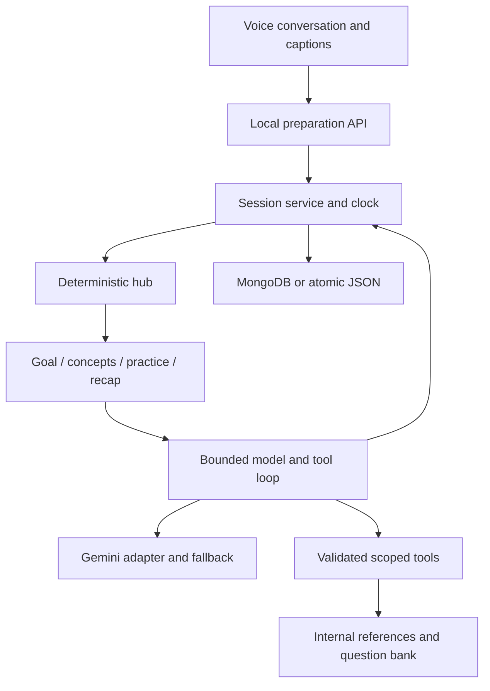

# Subject Prep architecture

Subject Prep is a voice-first learning conversation for eight technical subjects. The coach asks about the learner's goal, explains concepts, checks understanding, guides practical reasoning and finishes with a recap. Optional typed messages provide an accessible fallback. There is no notes page or code editor.

## Session flow

| Time | Specialist | Persisted phase | Responsibility |
| --- | --- | --- | --- |
| 0–5 minutes | Learning goal | `intro` | Identify what the learner wants to understand and their familiarity |
| 5–30 minutes | Concepts | `theory` | Explain briefly, check transfer, correct and retest weak topics |
| 30–55 minutes | Applied practice | `coding` | Discuss one practical scenario, approach, edge cases and tradeoffs |
| 55–60 minutes | Recap | `review` | Summarize demonstrated learning, gaps and the next practice step |

Phase IDs and stored source IDs are stable internal contracts. The `coding` phase and `assign_coding` tool select a practical exercise, but learners respond by speaking or typing an explanation; implementation is not required. The coach never claims code was executed. Existing code drafts remain exportable and new conversational turns do not attach them automatically.

Pause excludes paused time. Closing an active page does not pause the server clock. Next-phase controls move forward; early finish requests a recap. Timing and phase selection are server-owned. An answer crossing a phase boundary is assessed against its actual preceding question, with its original phase retained.

## Hub, loop and tools

The hub selects one specialist at a time. Each has its own instructions, tool permissions, message history and assessments. Handoffs share bounded goal context, current task and observed evidence. Specialists do not run as autonomous background processes or write each other's memories directly.

A turn validates input, locks the session, clones committed state, selects the role and prepares bounded subject evidence. The runtime sends only relevant role instructions and context. A model can request validated tools until `respond` returns a valid message and speech. The full successful turn is committed atomically; failures leave transcript, task, hints and request identity unchanged.

| Tool | Scope |
| --- | --- |
| `search_notes` | Selected-subject reference excerpts for any role |
| `get_questions` | Theory questions for concepts; practical tasks for applied practice |
| `assign_coding` | Select one existing task for the applied-practice conversation |
| `respond` | Validated message, concise speech, optional assessment and internal source IDs |

Generated Markdown links are reduced to their labels. Source IDs support evidence and memory internally; the UI never navigates to chapters. Retrieved text, answer guides, transcripts and memory are untrusted input. Tools expose no arbitrary shell, code execution or external file access.

## Memory and persistence

Short-term memory consists of per-role histories and hub handoffs. Long-term memory retrieves dated assessments for the configured learner and subject from committed sessions. It groups normalized topic labels, retains the latest two attempts per topic, and bounds retrieval to 24 topics / 20,000 serialized characters. Correct-after-partial/incorrect marks improvement; the latest verdict wins.

On entering concepts, the hub chooses a remembered weak topic when available. A validated `revisitMemoryId` adds a dated spoken and written reminder. This identifies a topic, not guaranteed exact question identity. Corrections and retest choices still depend on model quality. Goals, hints and requests for explanation are not evidence of failure. Historical answers do not count as current-session strengths.

`MONGODB_URI` enables MongoDB; an unavailable configured database fails startup. Defaults are database `subject_prep`, collection `preparation_sessions`, learner `local`. Existing installations retain their explicit database and collection settings. MongoDB uses one pool, majority writes, a learner/subject index and conditional single-document replacement for stale-write protection.

Without a MongoDB URI, JSON uses `PREP_STORAGE_DIR` (default `.sessions/`) and atomic temporary-file rename. Migration is insert-only and preserves source backups. One saved session contains transcript, assessments, role memories and request IDs. No separate profile write can outrun the transcript. Raw microphone audio is not persisted.

Browser storage holds preferences, the latest session ID and unsent drafts under `subject-prep` keys. Compatible reads preserve earlier local preferences and drafts without deleting old keys. The database and learner settings determine which server history is available.

## Voice conversation

Microphone capture sends bounded 16 kHz PCM over `/api/preparation/voice/live`. Server-side Gemini transcription streams captions. Manual activity detection keeps each recording in one activity; after capture is flushed and `activityEnd` is sent, the provider's finalized `inputTranscription` acknowledges the answer. Model-generation completion markers are independent of input transcription and are not required to submit it (see [Gemini live transcription](https://ai.google.dev/gemini-api/docs/live-api/live-transcribe) and the [Live API reference](https://ai.google.dev/api/live#bidigeneratecontentservercontent)). Silence alone never submits interim hypotheses; missing final transcripts still time out with the visible draft preserved. Spoken replies arrive as incremental 24 kHz PCM through `/api/preparation/speech/stream` and are buffered on the audio clock.

The client voice state machine rejects stale callbacks, cancels on pause/hidden tabs/errors, and opens the mic after completed playback. Automatic speaking/listening works in every phase, including practical reasoning. Explicit Stop/Interrupt and Escape cancel audio. A short thinking pause is configurable. Manual recording and complete-WAV playback remain capability fallbacks; no browser recognition or synthesis is used.

Only complete audio is cached for Replay. Truncated streams preserve the visible message but do not auto-open the microphone. Restored drafts and interrupted requests require review. The dialogue alternates turns; it is not full-duplex speech or voice-triggered interruption. Live microphone noise, device support, provider latency and quota affect performance.

## Limits and provider routing

The runtime shares a 90-second deadline, six model rounds and twelve tool calls across fallback attempts. Tool batches allow eight calls; results are bounded to 24,000 characters, context to 180,000, assessment context to 16,000, history to 28,000, messages to 240, answers to 10,000 and historical code to 30,000. Character budgets are not exact token or cost budgets.

Evidence preparation uses at most two tools, two note excerpts and two question excerpts. Roles receive only relevant prompts; the goal phase skips technical recall. Spoken replies normally target 20–45 words, with a longer final recap. Text is displayed after validation and persistence; streaming speech begins as audio arrives.

Gemini model choice and at most two ordered fallbacks come from the environment. Only quota errors or explicit 502/503/504 availability errors allow switching. Every model attempt starts from unchanged session state and discards tentative tools/signatures from failed attempts. All attempts share budgets. Quota cooldowns and availability cooldowns prevent retry storms. Speech and transcription have separate models and quotas; switching reasoning models does not fix speech quota.

## Local API and security

The API binds to `127.0.0.1` with exact host/origin checks, payload limits and in-memory request throttling. Canonical endpoints use `/api/preparation`. Ports are controlled by `PREP_PORT`, `PREP_WEB_PORT` and `PREP_PREVIEW_PORT`. Server secrets stay in root `.env`; frontend source does not receive credentials, private tool guides or specialist history. Vite blocks server/private-history paths.

This is a single local learner application. Session IDs and learner namespaces are not authentication. Public hosting needs ownership checks, authentication, HTTPS, distributed concurrency/rate limits, retention controls and spend limits.

## Verification

`npm run check` runs mocked provider, memory, persistence, voice, routing, UI and boundary regressions plus lint/build. `npm run db:check` separately uses a unique synthetic learner and cleans only its own records. Neither proves every coaching response correct or replaces a full-hour physical microphone test. See [requirements](REQUIREMENTS_VERIFICATION.md) and [audit](AGENT_AUDIT.md).
